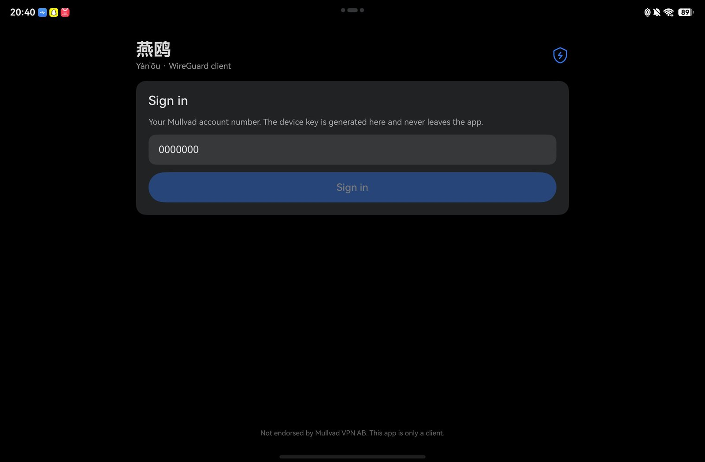
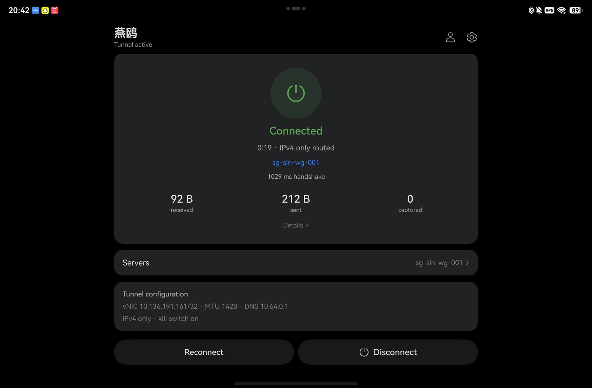
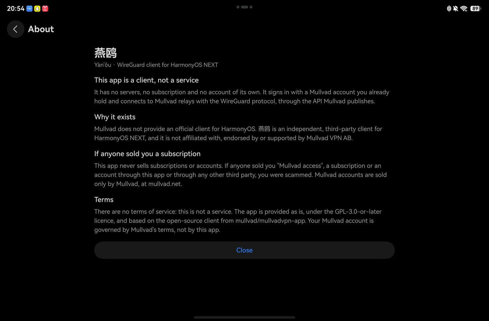

# 燕鸥 (Yàn'ōu)

**燕鸥 is a WireGuard client for HarmonyOS NEXT that connects to Mullvad VPN.** It uses a
Mullvad account you already hold: the app registers a WireGuard device with Mullvad's API,
downloads the signed relay list, and routes device traffic through the selected relay with
the system VPN extension.

It is a client only. It runs no servers, sells no subscriptions and holds no accounts; the
relays, the account and its five-device limit belong to Mullvad.

Mullvad does not provide an official client for HarmonyOS. 燕鸥 is an independent,
third-party client for that platform, and it is not affiliated with, endorsed by or
supported by Mullvad VPN AB.

Mullvad accounts are sold only by Mullvad, at <https://mullvad.net>. If anyone sold you a
subscription, an account or "Mullvad access" through this app or through any third party,
you were scammed. The app sells nothing and has no terms of service, because it is not a
service.

The client handles two kinds of filtered network. When `api.mullvad.net` is DNS-poisoned,
the API is reached through Mullvad's domain-fronting protocol rather than a direct HTTPS
request. When plain WireGuard is blocked, the tunnel can be wrapped in Mullvad's Shadowsocks
transport. Both paths are described in [Architecture](#architecture).

Tested on a Huawei MatePad (TGR-W00), HarmonyOS 6.1, SDK API 26, `compatibleSdkVersion
6.1.1(24)`. Only `arm64-v8a` is built.

## Screens

<p align="center">
  
  
</p>

Sign-in takes an account number you already hold and nothing else. Once connected, the home
screen shows the relay, the handshake time, the counters and the device IP version the
tunnel is running with.

<p align="center">
  
</p>

The About screen repeats the disclosure in the app: a client, not a service, not affiliated
with Mullvad, and a warning that anyone selling a subscription through a third party is a
scam.

## Features

- Sign-in with an account number, device registration through the Mullvad API, and key
  rotation on every sign-in.
- Signed relay list with a 24-hour cache, a server browser with search, favourites and
  recent relays.
- WireGuard over IPv4 or IPv6 relay endpoints.
- Device IP version setting: `IPv4 only` (default), `IPv6 only`, or both. Traffic from the
  excluded family is routed into the tunnel and dropped, and system blocking is enabled
  while a family is excluded.
- Transport ladder with plain WireGuard and Shadowsocks obfuscation, plus a protocol
  preference (`Automatic`, `WireGuard only`, `Obfuscated only`).
- Kill switch, which enables the system blocking mode. It is forced on when a family is
  excluded.
- Continuous background task and a status notification with Disconnect and Reconnect
  actions.
- Automatic rekey before the WireGuard session expires, and watchdogs for a stalled tunnel.
- Diagnostics: one log section per connection attempt, viewable in the app and exportable.

Not implemented: DAITA, multihop, LWO, QUIC/MASQUE, udp2tcp, per-application tunnelling,
DNS content blocking and custom DNS. The DAITA switch currently only filters the relay list
to relays that advertise support. `PORT-PLAN.md` section 7 describes what each would
require.

## Requirements

- DevEco Studio 6.x and a HarmonyOS SDK with API 26. The project is compatible with
  `6.1.1(24)`; older SDKs do not expose `vpnExtension` in the form used here.
- A Huawei developer account for signing. The signing service rejects non-developer
  accounts.
- Rust with the OHOS target:

  ```sh
  rustup target add aarch64-unknown-linux-ohos
  ```

- A device with developer mode and USB debugging enabled.

The tools from the SDK that are used directly:

```sh
HDC=/Applications/DevEco-Studio.app/Contents/sdk/default/openharmony/toolchains/hdc
NK=/Applications/DevEco-Studio.app/Contents/sdk/default/openharmony/native   # NDK, native build only
```

## Build

Native core (Rust cdylib and the C NAPI shim, installed to `entry/libs/arm64-v8a/`):

```sh
cd app
CARGO_HOME="$HOME/.cargo" ./scripts/build-native.sh
```

The first native build compiles `aws-lc-sys` and takes several minutes. The script takes the
NDK path from `YANOU_OHOS_NDK` or the default DevEco location, and uses the bundled cmake.

HAP:

```sh
export NODE_HOME=/Applications/DevEco-Studio.app/Contents/tools/node
export PATH="$NODE_HOME/bin:/Applications/DevEco-Studio.app/Contents/tools/hvigor/bin:$PATH"
export DEVECO_SDK_HOME=/Applications/DevEco-Studio.app/Contents/sdk
export TMPDIR="$PWD/../tmp"

hvigorw assembleHap --mode module -p product=default -p module=entry@default --no-daemon
```

## Install

A debug signing profile is bound to the UDIDs of the devices it was issued for. A HAP signed
for one device does not install on another, and the installer only reports "signature
verification failed".

1. Open `app/` in DevEco Studio and sign in with the Huawei developer account.
2. Connect the device and accept the debugging prompt.
3. Open `File > Project Structure > Project > Signing Configs` and enable
   `Automatically generate signature`. DevEco reads the UDID over `hdc` and writes the
   material to `~/.ohos/config/`: `*.p12` (key store), `*.cer` (certificate) and `*.p7b`
   (profile).
4. Copy the example build profile and let DevEco fill in the signing material:

   ```sh
   cp app/build-profile.example.json5 app/build-profile.json5
   ```

   `build-profile.json5` is ignored by git because it contains the store path and encrypted
   passwords.

To add another device, generate the signature with that device connected, or add its UDID to
the profile in AppGallery Connect.

Install and start:

```sh
hdc install -r entry/build/default/outputs/default/entry-default-signed.hap
hdc shell aa start -b com.maxime.muharmony -a EntryAbility
```

The bundle identifier is `com.maxime.muharmony`. It is fixed by the signing profile and by
the data of existing installations. The user-visible name comes from the label
`$string:app_name`, which is `燕鸥`.

### Distribution

A debug HAP installs only on devices listed in the profile. Other people can build it with
their own DevEco signing, or their UDID can be added to the profile.

Release or internal testing requires an AppGallery Connect app record, a release certificate
and profile, and review. A VPN client needs a licensed VPN service to be listed in mainland
China, so a personal client should be distributed outside that market, if at all.

### Scripts

| Script | Purpose |
|---|---|
| `app/scripts/build-native.sh` | cross-compile the Rust core and link the NAPI shim into `entry/libs/arm64-v8a/` |
| `app/scripts/shot.sh [name]` | screenshot the device into `tmp/` |
| `app/scripts/push-hap.sh` | copy the signed HAP into the device's `Download`, `Documents` and storage root |

## Architecture

### Processes

HarmonyOS does not allow a normal app to open a tunnel socket. The VPN runs as an extension
ability in a separate process, and the UI talks to it through the system VPN service.

```
EntryAbility (UI process, ArkTS)
   |  startVpnExtensionAbility(Want{ ipv6, ipVersion, killSwitch, target, relayCandidates, ... })
   v
YanouVpnAbility (separate process, ArkTS and Rust)
   |  vpnExtension.createVpnConnection(context).create(VpnConfig)
   |     -> tun fd, routes, DNS, MTU
   |  connection.protect(udpFd)
   |  native.tunnelStart(fd, ..., endpoint, ssEndpoint)
   v
libyanou_core.so (Rust: tun, gotatun, transports, API client)
   |  UDP datagrams to the relay
   v
relay (WireGuard server)
```

The UI never sees the tun file descriptor. State is published as a common event
(`VPN_STATE_EVENT`) once per second. The two processes do not share memory, so anything the
extension needs is either passed in the `Want` or read from the app sandbox.

### Connection sequence

1. The UI calls `startVpnExtensionAbility` with a `Want` containing the tunnel IPv4 address,
   the account's IPv6 address, the device IP version, the kill-switch flag, the selected
   target, the candidate relays (hostname, IPv4, IPv6, public key, Shadowsocks addresses),
   the expected device key and the diagnostics flag.
2. The extension reads the device key without creating one and compares it with the key
   registered for the account. A mismatch aborts the connection.
3. It builds a `VpnConfig` with the tunnel address, the default routes `0.0.0.0/0` and
   `::/0`, DNS `10.64.0.1`, MTU 1420, `isIPv6Accepted`, and `isBlocking`. The `::/0` route is
   always installed so that IPv6 traffic enters the tunnel in IPv4-only mode and is dropped
   there. `isBlocking` is enabled when a family is excluded or the kill switch is on.
4. The native core receives the families to forward. Only those families are added to the
   peer's allowed IPs, so the excluded family is dropped inside the tunnel.
5. `create()` returns the tun file descriptor. The engine's UDP socket is created, passed to
   `protect()`, and both descriptors are handed to Rust.
6. Rust creates a `gotatun` device on the descriptor with a transport factory and starts a
   handshake: 5 seconds per attempt, 3 minutes total, following the ladder below.
7. A completed handshake sets the phase to `connected`, and the UI starts the continuous
   background task and the notification.
8. On disconnect, failure or watchdog timeout, the extension destroys the connection,
   releasing the VPN slot and the notification.

### Native API

`app/rust/crates/core` is a `cdylib` with a C ABI. `app/entry/src/main/cpp/yanou_napi.c`
wraps it for ArkTS, which keeps the module free of `libc++_shared.so`.

| Function | Purpose |
|---|---|
| `mh_init(dir)` | set the directory for the key and the relay cache |
| `mh_rotate_key()` / `mh_clear_key()` / `mh_device_key()` | key lifecycle: create, delete, read |
| `mh_open_relay_socket(family)` | UDP socket the engine uses, IPv4 or IPv6 |
| `mh_set_ip_version(families)` | families the peer forwards |
| `mh_tunnel_start(fd, mtu, peer, endpoint, port, ss)` | create the WireGuard device and start the handshake |
| `mh_tunnel_status()` | running state, handshake, counters, handshake age, last error |
| `mh_api_*` | login, devices, account and relay list |

`tunnel.rs` contains the gotatun device, `obfs.rs` the transports and `api.rs` the Mullvad
HTTP client.

### Transports and address families

The transport ladder is:

```
direct-v6  ->  shadowsocks-v4  ->  direct-v4  ->  shadowsocks-v6
```

`direct` connects to the relay's `ipv6_addr_in` or `ipv4_addr_in`. Ports are tried in this
order: 51820, 53, 123, then a random port from 4000-33433, 33565-51819 or 52001-60000.

`shadowsocks` connects to the relay's `shadowsocks_extra_addr_in` address on ports
51900-51949, using `aes-256-gcm` with the password `mullvad`. Each WireGuard datagram is
wrapped, with `127.0.0.1:51820` as the inner destination.

The ladder iterates relays within one transport before moving to the next transport.

Two address families are configured separately:

- The outer family is how the client reaches the relay, given by the `-v4` or `-v6` suffix
  in the ladder.
- The inner family is what the tunnel forwards, given by the device IP version setting.

The ladder starts with IPv6 transports because they survive some filtered networks. The
default inner family is IPv4. The protocol preference selects the transport subset:
`WireGuard only`, `Obfuscated only`, or `Automatic`.

When a connected tunnel drops, the client retries the same relay twice, then one different
relay, then reports failure with a notification.

### API access

`api.mullvad.net` is DNS-poisoned on some networks. `api.rs` uses domain fronting: a TLS
connection to CDN77 with `SNI=www.phpmyadmin.net`, Mullvad's `domain-fronting` multiplexing
protocol, and a second TLS connection to the API inside it.

The direct, unfronted path is disabled by default because it resolves `api.mullvad.net` and
sends that name as the TLS SNI. The `Direct connection` setting enables it; a 4-second
timeout applies, and a failure disables direct attempts for ten minutes.

The relay list is fetched signed from `/trl/v1/...` and stored in `relays.json` with
hostname, IPv4, IPv6, public key, country, city, DAITA flag and Shadowsocks addresses. The
cache is reused for 24 hours, and a missing field forces a refresh.

### Keys and secrets

- The WireGuard private key is a `0600` file in the app sandbox.
- Sign-in rotates the key: the old key is deleted, a new one is generated and registered,
  because Mullvad does not accept a reused device key. Sign-out deletes the device and the
  key.
- The extension opens the key read-only. If it is missing, the connection fails instead of
  generating an unregistered key.
- The account token is stored in the HUKS-backed Asset Store.

### Background operation

- A continuous task (`backgroundTaskManager.startBackgroundRunning`, `dataTransfer` mode)
  keeps the extension process alive. The mode must be declared in `module.json5` under
  `abilities[].backgroundModes`, otherwise the call fails with `9800005`.
- The status notification provides Disconnect and Reconnect actions. They start
  `EntryAbility` with a `notificationAction` parameter, which the page reads from
  `AppStorage`, so the actions work while the UI is frozen.
- The stats loop calls `force_handshake` when the last handshake is more than 100 seconds
  old. WireGuard expires a session after about three minutes without a rekey, so an idle
  tunnel needs this to stay up.
- The extension reports the tunnel as dead after 90 seconds without traffic or 240 seconds
  without a key exchange, and rebuilds it on the next relay.
- The UI reports "Connection lost" after five seconds without a state broadcast. This check
  is suspended while the page is in the background, because HarmonyOS stops delivering
  broadcasts there, and it allows five seconds after the page becomes visible again.

## Platform notes

| Symptom | Cause | Fix |
|---|---|---|
| `401 Parameter error` from `create()` | the session stores `ipv4` as a CIDR (`10.170.64.72/32`); `LinkAddress` requires the address and prefix separately | split on `/` |
| `9800005` from `startBackgroundRunning` | background mode not declared | `backgroundModes: ["dataTransfer"]` in `module.json5` |
| VPN dies in the background | no continuous task | continuous task, notification and watchdog |
| "No device key on this tablet" after re-login | an in-flight login completed after sign-out and registered a key whose file had been deleted | auth generation counter; the extension opens the key read-only |
| Handshake packets leave, relay never answers | relay key not registered, or the network drops the relay address | key check, then the IPv6 and obfuscation ladder |
| `ifconfig` shows no IPv6 | HarmonyOS `ifconfig` does not print `inet6`, including for `lo` | test with `ping6`, and dial `ipv6_addr_in` |
| List content vertically centred in `Scroll` | `Scroll` defaults to `Alignment.Center` when the child is smaller than the viewport | `.align(Alignment.TopStart)` |
| `sys.symbol.square_on_square` not found | symbol names differ from the Android and iOS sets | use a symbol that exists in the SDK table, for example `doc_text_on_doc_text` |
| Healthy tunnel reported as "Connection lost" after backgrounding | the UI watchdog treated suspended broadcasts as silence | track `onPageShow` and `onPageHide`, and allow five seconds after resume |

## Legal

The app is distributed under GPL-3.0-or-later and comes with no warranty; [`LICENSE`](LICENSE)
is the whole agreement. There are no terms of service, because there is no service to agree
to.

Your Mullvad account is governed by [Mullvad's terms of
service](https://mullvad.net/en/help/terms-service), not by this project. 燕鸥 is not a party
to that agreement.

The app collects nothing. It keeps the account token in the device keystore and the WireGuard
key in the app sandbox, and it contacts only Mullvad's API and the relay you select.

## Repository

```
app/                         DevEco project
  entry/src/main/ets/        ArkTS: UI, VPN extension, settings, diagnostics
  entry/src/main/cpp/        C NAPI shim (yanou_napi.c) and typings
  entry/libs/arm64-v8a/      built native libraries (ignored by git)
  rust/crates/core/          Rust: tunnel, transports, API client (crate yanou-core)
  scripts/                   build-native, screenshot, push-HAP
PORT-PLAN.md                 feasibility study, milestones, roadmap, UI backlog
ANDROID-PATH-REPORT.md       the official client's connect path, step by step
```

The port follows the upstream client's split between tunnel, obfuscation and API:

| Android client | 燕鸥 |
|---|---|
| `talpid-wireguard` | `app/rust/crates/core/src/tunnel.rs` |
| `tunnel-obfuscation::shadowsocks` | `app/rust/crates/core/src/obfs.rs` |
| `mullvad-api` | `app/rust/crates/core/src/api.rs` |
| `VpnService.protect` | `VpnConnection.protect` in the extension |
| `RETRY_ORDER` | `LADDER` in `VpnExtensionAbility.ets` |

`ANDROID-PATH-REPORT.md` traces the official connect path from the Connect button through
the daemon and `VpnService` to the tunnel, and compares it with this client.

## Licence

GPL-3.0-or-later, as is the client this is derived from. See [`LICENSE`](LICENSE). The
domain-fronting strategy, the transport design and much of the WireGuard configuration come
from `mullvad/mullvadvpn-app` and remain under their authors' copyright.

## Name

"燕鸥" (yàn'ōu) is the Chinese name for the tern, a seabird. The app is named after the
bird; the name does not reference any VPN brand.
